# PulseHub

Hub de télémétrie UDP pour une flotte d'équipements IoT, avec un simulateur de devices (et d'incidents) et un tableau de bord web temps réel. TypeScript strict sur Node 22, aucune dépendance d'exécution.

- **Simulateur** : N devices envoient des trames binaires PulseHub v1 en UDP, avec injection de défauts (checksum, doublons, réordonnancement, valeurs anormales, reboots, arrêts, surchauffe).
- **Hub** : reçoit les datagrammes, les valide, détecte pertes/doublons/retards/reboots, calcule l'état de la flotte et des alertes.
- **Dashboard** : page web servie par le hub, alimentée en Server-Sent Events.

## 1. Démarrage local

### Prérequis

| Outil | Version |
|---|---|
| Node.js | >= 22.9 (requis pour `--env-file-if-exists`) |
| npm | fourni avec Node (testé avec Node 22.23) |

### Installation

```bash
npm ci
cp .env.example .env   # optionnel : sans .env, les valeurs par défaut s'appliquent
```

Sans `.env`, Node affiche une seule fois `.env not found. Continuing without it.` : c'est normal.

### Commandes

| Action | Commande |
|---|---|
| Lancer le hub (UDP 9000 + dashboard) | `npm run hub` puis ouvrir http://localhost:8080 |
| Lancer le simulateur (50 devices x 20 Hz, sans défaut) | `npm run sim` (dans un 2e terminal) |
| Aide du simulateur | `npm run sim -- --help` |
| Tests | `npm test` |
| Lint | `npm run lint` |
| Typecheck | `npm run typecheck` |

Le hub affiche aussi une ligne d'état dans la console toutes les 2 s (`fps=… accepted=… lost=… health=… online=…/… alerts=…`). `Ctrl+C` arrête proprement le hub et le simulateur (le simulateur affiche alors ses totaux). Si le port UDP ou HTTP est déjà pris, le hub libère ce qu'il avait ouvert, affiche `PulseHub hub failed to start: …` et sort avec le code 1.

### Démo des défauts

```bash
npm run sim -- --fault-checksum 0.01 --fault-dup 0.01 --fault-reorder 0.01 \
  --fault-anomaly 0.01 --fault-reboot 0.0005 --fault-stop 2 --hot-ids 7
```

Les probabilités s'appliquent à chaque trame (à 1000 trames/s, `0.01` donne environ 10 défauts/s). `--fault-stop 2` tire 2 devices au hasard (utiliser `--stop-ids 3,4` pour choisir).

### Options du simulateur

Priorité : flag, puis variable d'environnement, puis valeur par défaut. Un argument invalide affiche l'erreur et sort avec le code 2.

| Flag | Env | Défaut | Rôle |
|---|---|---|---|
| `--devices` | `SIM_DEVICES` | 50 | nombre de devices simulés (ids 1..N) |
| `--hz` | `SIM_HZ` | 20 | trames par seconde et par device |
| `--host` | `SIM_HOST` | 127.0.0.1 | hôte du hub |
| `--port` | `SIM_PORT` | 9000 | port UDP du hub |
| `--heartbeat-every` | | 20 | une trame sur N est un heartbeat |
| `--tick-ms` | | 5 | période de l'ordonnanceur (ms) |
| `--stats-interval-ms` | | 1000 | période de la ligne de stats (ms) |
| `--seq-start` | | 0 | seq initial de chaque device (ex. `4294967290` pour tester le wraparound) |
| `--fault-checksum` | | 0 | probabilité de checksum corrompu |
| `--fault-dup` | | 0 | probabilité de trame envoyée deux fois |
| `--fault-reorder` | | 0 | probabilité de trame envoyée après la suivante |
| `--fault-anomaly` | | 0 | probabilité de valeur anormale (85 °C, 20000 mV ou 12000 mA) |
| `--fault-reboot` | | 0 | probabilité de reboot (seq et uptime remis à 0) |
| `--fault-stop` | | 0 | nombre de devices tirés au hasard qui s'arrêtent |
| `--stop-ids` | | aucun | ids des devices qui s'arrêtent (remplace `--fault-stop`) |
| `--stop-after-ms` | | 10000 | délai avant que ces devices se taisent |
| `--hot-ids` | | aucun | ids des devices qui surchauffent et restent chauds |
| `--hot-after-ms` | | 5000 | délai avant le début de la chauffe |
| `--help` | | | affiche l'aide |

### Variables d'environnement du hub

Toutes sont des entiers, validés au démarrage (bornes, et `WARN < CRIT`, `MIN < MAX`) ; une valeur invalide arrête le hub avec un message explicite.

| Variable | Défaut | Rôle |
|---|---|---|
| `HUB_PORT` | 9000 | port UDP d'écoute |
| `HTTP_PORT` | 8080 | port du dashboard |
| `SNAPSHOT_INTERVAL_MS` | 250 | période d'envoi des snapshots aux navigateurs |
| `OFFLINE_AFTER_MS` | 2000 | silence au-delà duquel un device est OFFLINE |
| `TEMP_WARN_C` | 60 | température WARN (°C, inclusif) |
| `TEMP_CRIT_C` | 70 | température CRIT (°C, inclusif) ; l'alerte se déclenche strictement au-dessus |
| `VOLTAGE_MIN_MV` | 22000 | tension minimale (mV) |
| `VOLTAGE_MAX_MV` | 26000 | tension maximale (mV) |
| `CURRENT_MAX_MA` | 10000 | courant maximal (mA) |
| `ALERT_DURATION_MS` | 3000 | durée pendant laquelle une condition doit tenir pour lever une alerte |
| `LOSS_WARN_PCT` | 1 | seuil WARN de la santé de réception (taux de perte et taux d'invalides, %) |
| `LOSS_CRIT_PCT` | 5 | seuil CRIT de la santé de réception (%) |
| `RATE_WINDOW_MS` | 1000 | fenêtre glissante du calcul de trames/s |
| `REBOOT_UPTIME_DROP_MS` | 1000 | chute d'uptime au-delà de laquelle on conclut à un reboot |

Le fichier `.env.example` contient aussi `SIM_HOST`, `SIM_PORT`, `SIM_DEVICES`, `SIM_HZ` pour le simulateur.

### Scénario de recette

1. `npm run hub`, ouvrir http://localhost:8080 : badge `LIVE`, tous les compteurs à 0, "Waiting for devices", "No active alerts", "No readings yet".
2. `npm run sim` : en 1 à 2 s, `frames/s` monte vers 1000, la flotte affiche 50 devices OK, les températures (autour de 40 °C), tensions et courants bougent à chaque rafraîchissement (4 fois par seconde).
3. Arrêter le simulateur et lancer la démo des défauts. Où voir chaque défaut :

| Défaut | Où le voir sur le dashboard |
|---|---|
| `--fault-checksum` | panneau Reception : `invalid`, `invalid %`, tuile `BAD_CHECKSUM` surlignée dans "Invalid by reason" ; la trame manquante compte aussi dans `lost` |
| `--fault-dup` | Reception : `duplicates` ; carte du device : `dup` |
| `--fault-reorder` | Reception : `late` et `lost`, `loss %` proche de 1 % ; badge de santé qui passe à WARN ; carte : `late`, `lost` |
| `--fault-anomaly` | cartes qui passent brièvement en WARN/CRIT et compteurs `warn`/`crit` du panneau Fleet (la valeur anormale ne dure qu'une trame, donc pas d'alerte) |
| `--fault-reboot` | carte du device : `reboots` |
| `--fault-stop` / `--stop-ids` | après 10 s (`--stop-after-ms`) + 2 s (`OFFLINE_AFTER_MS`) : carte OFFLINE ("seen … ago" qui grandit), compteur `offline` de Fleet, le device sort du Top 5 |
| `--hot-ids 7` | après 5 s, la température du device 7 monte de 20 °C/s jusqu'à 85 °C : carte WARN puis CRIT, 1re place du "Top 5 hottest", puis après 3 s au-dessus de 70 °C, alerte "Temperature above 70 °C" dans "Active alerts" avec sa durée |

## 2. Architecture

```mermaid
flowchart LR
  subgraph SIM["Simulateur - npm run sim"]
    DEV["Device x N<br/>random walk, seq, uptime"]
    RB["RebootFault<br/>avant chaque trame"]
    ENC["toDatagram<br/>encodeFrame"]
    ST["FaultStages<br/>Stop, Hot, Anomaly,<br/>Checksum, Reorder, Duplicate"]
    TX["UdpSender"]
    RB --> DEV --> ENC --> ST --> TX
  end

  TX -- "UDP :9000<br/>trames PulseHub v1" --> RX

  subgraph HUB["Hub - npm run hub"]
    RX["UdpReceiver"] --> PL["FramePipeline"]
    PL --> DEC["decodeFrame<br/>FRAME_CHECKS"]
    DEC -- "invalide" --> RS["ReceptionStats"]
    DEC -- "valide" --> SEQ["Sequencer"]
    SEQ -- "verdict" --> RS
    SEQ -- "verdict" --> REG["DeviceRegistry"]
    REG -- "si accepted" --> AE["AlertEngine"]
    RS --> FS["FleetSummary.snapshot"]
    REG --> FS
    DS["DeviceStatusEvaluator<br/>StatusRules + OFFLINE"] --> FS
    AE --> FS
    FS --> SB["SnapshotBroadcaster<br/>toutes les SNAPSHOT_INTERVAL_MS"]
    FS --> SL["Ligne d'état console<br/>toutes les 2 s"]
    SF["StaticFileHandler"]
    SB --> HTTP["HttpServer :8080"]
    SF --> HTTP
  end

  HTTP -- "GET /events (SSE)<br/>GET / , /app.js, /style.css" --> WEB["Navigateur<br/>public/app.js"]
```



### Arborescence

```
src/
  protocol/    format PulseHub v1 partagé : constantes, encodeur, décodeur, règles de validation, Result
  simulator/   CLI, devices, ordonnanceur, défauts (faults/), envoi UDP
  hub/         config, réception UDP, pipeline, séquencement, stats, registre, statuts, alertes, snapshot
    http/      serveur HTTP natif, fichiers statiques, diffusion SSE
public/        dashboard : index.html, app.js (vanilla), style.css
tests/         tests vitest, miroir de src/ (protocol, simulator, hub, hub/http)
.github/       CI GitHub Actions : npm ci, lint, typecheck, test
```

### Protocole et ordre de validation

Trame big-endian : `magic` u16 (`0x5048`, "PH") | `version` u8 (1) | `type` u8 (1 = TELEMETRY, 2 = HEARTBEAT) | `deviceId` u16 | `seq` u32 | `uptimeMs` u32 | `count` u8 | `count` mesures de 3 octets (`metricId` u8 + `value` int16) | `checksum` u8 (XOR de tous les octets précédents). Taille de 16 à 512 octets. Métriques : 1 = température en centièmes de °C, 2 = tension en mV, 3 = courant en mA ; un `metricId` inconnu est ignoré sans rejeter la trame.

Le décodeur applique les règles dans cet ordre, la première violée donne la raison du rejet : `TOO_SHORT`, `TOO_LONG`, `BAD_MAGIC`, `BAD_VERSION`, `LENGTH_MISMATCH`, `BAD_CHECKSUM`, `UNKNOWN_TYPE`, `INVALID_DEVICE_ID`, `HEARTBEAT_WITH_MEASUREMENTS`.

- Les contrôles de taille passent d'abord : ils garantissent que toutes les lectures suivantes (dont la position du checksum) restent dans le buffer.
- Magic et version ensuite : un datagramme étranger ou d'une autre version n'a pas la même structure.
- Le **checksum passe avant** les contrôles de type, de device et de heartbeat : si un octet a été corrompu en transit, la trame est classée `BAD_CHECKSUM` (corruption) et non `UNKNOWN_TYPE` ou `INVALID_DEVICE_ID` (erreur d'émetteur). On ne juge le sens des champs que sur une trame intacte, ce qui rend les compteurs par raison fiables pour le diagnostic.

## 3. Synthèse et visualisation

Le hub calcule un `FleetSnapshot`, objet JSON simple envoyé tel quel au navigateur :

| Élément | Contenu | Utilité en salle de contrôle |
|---|---|---|
| Santé de la réception | reçues, valides, invalides (par raison), acceptées, doublons, en retard, perdues, trames/s, % de perte, % d'invalides, niveau OK/WARN/CRIT | "la réception est-elle saine ?" : distingue un problème réseau (pertes, retards) d'un problème d'émetteur (checksum, format) |
| Statut par device | OK / WARN / CRIT d'après les seuils de température, tension et courant ; OFFLINE après `OFFLINE_AFTER_MS` de silence | "qui ne répond plus ?" et "qui sort de sa plage ?" d'un coup d'œil (couleur de la carte) |
| Comptes de la flotte | total, en ligne, OK, WARN, CRIT, OFFLINE | taille de l'incident : un device isolé ou toute la flotte |
| Top 5 des plus chauds | les 5 devices en ligne avec la température la plus haute | "qui chauffe ?" sans parcourir la grille |
| Alertes à durée | une condition (température > CRIT, tension hors plage, surintensité) tenue au moins `ALERT_DURATION_MS`, avec sa durée | filtre les pics isolés : on n'alerte que sur un problème qui dure |

Choix de visualisation, sous la contrainte d'une journée :

- **Serveur HTTP natif de Node** (`node:http`) : seulement 2 types de routes (4 fichiers statiques en liste blanche et `/events`). NestJS ou Express n'apporteraient rien ici, ajouteraient une dépendance et du code à justifier ; tout doit pouvoir s'expliquer ligne à ligne.
- **SSE plutôt que WebSocket** : le flux est à sens unique (hub vers navigateur), `EventSource` est natif dans le navigateur, se reconnecte seul, et ne demande aucune dépendance côté serveur (WebSocket aurait demandé `ws`).
- **Snapshots cadencés plutôt qu'un push par trame** : le hub reçoit environ 1000 trames/s ; on envoie un snapshot complet toutes les `SNAPSHOT_INTERVAL_MS` (250 ms), ce qui borne le trafic et le travail du navigateur, quel que soit le débit UDP.
- **Page vanilla** (HTML, CSS, JS sans build) : pas de framework front pour une page qui ne fait que rendre un JSON.

## 4. Principes de conception

Les liens pointent vers le commit `f7675eb` de `main`.

**SRP (responsabilité unique).** Chaque classe a une seule raison de changer : `FramePipeline` ne fait qu'orchestrer le flux d'une trame, `RateMeter` ne fait que compter des événements sur une fenêtre glissante.
- [src/hub/pipeline.ts#L19-L37](https://github.com/lucassrblt/PulseHub/blob/f7675eb680110f3bbdf0573f60e5fd65d3b21e92/src/hub/pipeline.ts#L19-L37)
- [src/hub/rateMeter.ts#L5-L32](https://github.com/lucassrblt/PulseHub/blob/f7675eb680110f3bbdf0573f60e5fd65d3b21e92/src/hub/rateMeter.ts#L5-L32)

**OCP (ouvert/fermé).** Ajouter une règle de validation, de statut ou d'alerte revient à ajouter un élément à une liste, sans modifier le code qui la parcourt.
- Règles du décodeur `FRAME_CHECKS` : [src/protocol/checks.ts#L86-L97](https://github.com/lucassrblt/PulseHub/blob/f7675eb680110f3bbdf0573f60e5fd65d3b21e92/src/protocol/checks.ts#L86-L97), parcourues par [src/protocol/decoder.ts#L15-L23](https://github.com/lucassrblt/PulseHub/blob/f7675eb680110f3bbdf0573f60e5fd65d3b21e92/src/protocol/decoder.ts#L15-L23)
- `StatusRule` : [src/hub/statusRules.ts#L29-L36](https://github.com/lucassrblt/PulseHub/blob/f7675eb680110f3bbdf0573f60e5fd65d3b21e92/src/hub/statusRules.ts#L29-L36)
- `AlertRule` : [src/hub/alertRules.ts#L11-L31](https://github.com/lucassrblt/PulseHub/blob/f7675eb680110f3bbdf0573f60e5fd65d3b21e92/src/hub/alertRules.ts#L11-L31)
- Défauts du simulateur, enchaînés par `runStages` : [src/simulator/faults/stage.ts#L31-L37](https://github.com/lucassrblt/PulseHub/blob/f7675eb680110f3bbdf0573f60e5fd65d3b21e92/src/simulator/faults/stage.ts#L31-L37)

**LSP (substitution de Liskov).** Tous les défauts respectent le même contrat `FaultStage` (un datagramme en entrée, zéro, un ou plusieurs en sortie) et sont interchangeables dans la liste ; de même, `FakeClock` remplace l'horloge système dans les tests sans changer le comportement attendu.
- [src/simulator/faults/stage.ts#L16-L19](https://github.com/lucassrblt/PulseHub/blob/f7675eb680110f3bbdf0573f60e5fd65d3b21e92/src/simulator/faults/stage.ts#L16-L19)
- [src/simulator/main.ts#L27-L41](https://github.com/lucassrblt/PulseHub/blob/f7675eb680110f3bbdf0573f60e5fd65d3b21e92/src/simulator/main.ts#L27-L41)
- [tests/hub/fakeClock.ts#L3-L14](https://github.com/lucassrblt/PulseHub/blob/f7675eb680110f3bbdf0573f60e5fd65d3b21e92/tests/hub/fakeClock.ts#L3-L14)

**ISP (ségrégation des interfaces).** Les stats, le registre et le moteur d'alertes exposent un côté écriture (utilisé par le pipeline) et un côté lecture (utilisé par le snapshot) : chaque client ne dépend que de ce qu'il utilise.
- [src/hub/receptionStats.ts#L26-L36](https://github.com/lucassrblt/PulseHub/blob/f7675eb680110f3bbdf0573f60e5fd65d3b21e92/src/hub/receptionStats.ts#L26-L36)
- [src/hub/deviceRegistry.ts#L18-L26](https://github.com/lucassrblt/PulseHub/blob/f7675eb680110f3bbdf0573f60e5fd65d3b21e92/src/hub/deviceRegistry.ts#L18-L26)
- [src/hub/alertEngine.ts#L14-L22](https://github.com/lucassrblt/PulseHub/blob/f7675eb680110f3bbdf0573f60e5fd65d3b21e92/src/hub/alertEngine.ts#L14-L22)
- Le pipeline ne voit que les côtés écriture : [src/hub/pipeline.ts#L10-L17](https://github.com/lucassrblt/PulseHub/blob/f7675eb680110f3bbdf0573f60e5fd65d3b21e92/src/hub/pipeline.ts#L10-L17) ; le snapshot que les côtés lecture : [src/hub/fleetSummary.ts#L40-L48](https://github.com/lucassrblt/PulseHub/blob/f7675eb680110f3bbdf0573f60e5fd65d3b21e92/src/hub/fleetSummary.ts#L40-L48)

**DIP (inversion des dépendances).** Les modules de haut niveau dépendent d'abstractions : le `SnapshotBroadcaster` dépend de `SnapshotProvider`, pas de `FleetSummary` ; le simulateur dépend de ports (`Clock`, `Random`, `Timer`, `DatagramSender`), pas de `dgram` ni de `setInterval`.
- [src/hub/http/snapshotBroadcaster.ts#L31-L40](https://github.com/lucassrblt/PulseHub/blob/f7675eb680110f3bbdf0573f60e5fd65d3b21e92/src/hub/http/snapshotBroadcaster.ts#L31-L40)
- [src/hub/fleetSummary.ts#L35-L38](https://github.com/lucassrblt/PulseHub/blob/f7675eb680110f3bbdf0573f60e5fd65d3b21e92/src/hub/fleetSummary.ts#L35-L38)
- [src/simulator/ports.ts#L1-L21](https://github.com/lucassrblt/PulseHub/blob/f7675eb680110f3bbdf0573f60e5fd65d3b21e92/src/simulator/ports.ts#L1-L21)

**DRY.** Le format binaire n'est écrit qu'une fois : `encodeFrame` sert au simulateur et aux tests, et encodeur comme règles de validation partagent les mêmes helpers de layout. Les options du simulateur sont définies une seule fois et servent à la fois au parsing et à `--help`.
- [src/protocol/encoder.ts#L6-L29](https://github.com/lucassrblt/PulseHub/blob/f7675eb680110f3bbdf0573f60e5fd65d3b21e92/src/protocol/encoder.ts#L6-L29), utilisé par le simulateur [src/simulator/faults/stage.ts#L26-L29](https://github.com/lucassrblt/PulseHub/blob/f7675eb680110f3bbdf0573f60e5fd65d3b21e92/src/simulator/faults/stage.ts#L26-L29) et par les tests [tests/protocol/decoder.test.ts#L53-L55](https://github.com/lucassrblt/PulseHub/blob/f7675eb680110f3bbdf0573f60e5fd65d3b21e92/tests/protocol/decoder.test.ts#L53-L55)
- [src/protocol/layout.ts#L3-L16](https://github.com/lucassrblt/PulseHub/blob/f7675eb680110f3bbdf0573f60e5fd65d3b21e92/src/protocol/layout.ts#L3-L16)
- [src/simulator/config.ts#L254-L262](https://github.com/lucassrblt/PulseHub/blob/f7675eb680110f3bbdf0573f60e5fd65d3b21e92/src/simulator/config.ts#L254-L262)

**KISS.** Le séquenceur ne garde que le plus grand seq accepté par device (high-water mark) : quelques lignes, faciles à tester et à expliquer. Les fichiers statiques sont une liste blanche fixe plutôt qu'une résolution de chemins (pas de risque de path traversal).
- [src/hub/sequencer.ts#L30-L58](https://github.com/lucassrblt/PulseHub/blob/f7675eb680110f3bbdf0573f60e5fd65d3b21e92/src/hub/sequencer.ts#L30-L58)
- [src/hub/http/staticFiles.ts#L13-L18](https://github.com/lucassrblt/PulseHub/blob/f7675eb680110f3bbdf0573f60e5fd65d3b21e92/src/hub/http/staticFiles.ts#L13-L18)

**Séparation des préoccupations.** Trois couches distinctes : le protocole (pur, sans I/O), le transport (UDP et HTTP), la logique métier (stats, statuts, alertes) ; le navigateur ne fait que rendre un snapshot déjà calculé.
- Transport UDP seul : [src/hub/udpReceiver.ts#L7-L51](https://github.com/lucassrblt/PulseHub/blob/f7675eb680110f3bbdf0573f60e5fd65d3b21e92/src/hub/udpReceiver.ts#L7-L51)
- Contrat de données vers la vue : [src/hub/fleetSummary.ts#L24-L33](https://github.com/lucassrblt/PulseHub/blob/f7675eb680110f3bbdf0573f60e5fd65d3b21e92/src/hub/fleetSummary.ts#L24-L33)
- Rendu côté navigateur : [public/app.js#L159-L165](https://github.com/lucassrblt/PulseHub/blob/f7675eb680110f3bbdf0573f60e5fd65d3b21e92/public/app.js#L159-L165)

**Injection de dépendances.** `main.ts` est la seule racine de composition : il crée et relie tous les objets. Le temps (`Clock`), les minuteries (`Timer`) et l'aléatoire (`Random`) sont injectés, ce qui rend déterministes les tests de fenêtres, d'OFFLINE, d'alertes à durée et de défauts.
- Racine de composition du hub : [src/hub/main.ts#L26-L55](https://github.com/lucassrblt/PulseHub/blob/f7675eb680110f3bbdf0573f60e5fd65d3b21e92/src/hub/main.ts#L26-L55), et du simulateur : [src/simulator/main.ts#L59-L82](https://github.com/lucassrblt/PulseHub/blob/f7675eb680110f3bbdf0573f60e5fd65d3b21e92/src/simulator/main.ts#L59-L82)
- [src/hub/clock.ts#L1-L9](https://github.com/lucassrblt/PulseHub/blob/f7675eb680110f3bbdf0573f60e5fd65d3b21e92/src/hub/clock.ts#L1-L9), [src/hub/timer.ts#L4-L15](https://github.com/lucassrblt/PulseHub/blob/f7675eb680110f3bbdf0573f60e5fd65d3b21e92/src/hub/timer.ts#L4-L15)

**Gestion des erreurs.** Les erreurs attendues sont des valeurs (`Result`), pas des exceptions : le décodeur ne lève jamais, même sur des octets aléatoires. Le récepteur UDP isole chaque datagramme pour ne jamais faire tomber le process. Au démarrage, un échec de port arrête ce qui était déjà lancé et sort avec le code 1.
- [src/protocol/types.ts#L42-L45](https://github.com/lucassrblt/PulseHub/blob/f7675eb680110f3bbdf0573f60e5fd65d3b21e92/src/protocol/types.ts#L42-L45)
- [src/protocol/decoder.ts#L8-L13](https://github.com/lucassrblt/PulseHub/blob/f7675eb680110f3bbdf0573f60e5fd65d3b21e92/src/protocol/decoder.ts#L8-L13)
- [src/hub/udpReceiver.ts#L44-L50](https://github.com/lucassrblt/PulseHub/blob/f7675eb680110f3bbdf0573f60e5fd65d3b21e92/src/hub/udpReceiver.ts#L44-L50)
- [src/hub/startup.ts#L7-L21](https://github.com/lucassrblt/PulseHub/blob/f7675eb680110f3bbdf0573f60e5fd65d3b21e92/src/hub/startup.ts#L7-L21) et [src/hub/main.ts#L73-L76](https://github.com/lucassrblt/PulseHub/blob/f7675eb680110f3bbdf0573f60e5fd65d3b21e92/src/hub/main.ts#L73-L76)

**Configuration.** Aucun paramètre d'exécution en dur : le hub lit l'environnement, applique des valeurs par défaut, valide bornes et cohérence (WARN < CRIT) et échoue tôt avec un message clair ; le simulateur applique flag > env > défaut.
- Valeurs par défaut et bornes : [src/hub/config.ts#L40-L55](https://github.com/lucassrblt/PulseHub/blob/f7675eb680110f3bbdf0573f60e5fd65d3b21e92/src/hub/config.ts#L40-L55)
- Validation : [src/hub/config.ts#L80-L98](https://github.com/lucassrblt/PulseHub/blob/f7675eb680110f3bbdf0573f60e5fd65d3b21e92/src/hub/config.ts#L80-L98)
- Priorité flag > env > défaut : [src/simulator/config.ts#L276-L289](https://github.com/lucassrblt/PulseHub/blob/f7675eb680110f3bbdf0573f60e5fd65d3b21e92/src/simulator/config.ts#L276-L289)

## 5. Choix et compromis

### Outils retenus

| Outil | Raison |
|---|---|
| TypeScript strict (+ `noUncheckedIndexedAccess`) | types des trames et des verdicts vérifiés à la compilation, pas de `any` |
| tsx | exécute le TypeScript directement, sans étape de build |
| vitest | rapide, TypeScript et ESM sans configuration |
| eslint + typescript-eslint | règles recommandées, `no-explicit-any` et types de retour explicites sur les exports |
| `node:dgram` | UDP natif, suffisant pour émettre et recevoir |
| `node:http` | 2 routes, pas besoin de framework |
| `node:util` `parseArgs` | CLI du simulateur sans dépendance |
| `node --env-file-if-exists=.env` | chargement du `.env` natif, optionnel, affiché une seule fois |
| Aucune dépendance d'exécution | tout est dans Node ; seules des devDependencies |

### Outils écartés

| Outil | Pourquoi |
|---|---|
| NestJS / Express | surdimensionnés pour 2 routes, du code à expliquer en plus |
| `ws` | WebSocket inutile pour un flux à sens unique, SSE est natif |
| Parseur binaire (bibliothèque) | interdit par le sujet ; `DataView` suffit |
| dotenv | remplacé par l'option native de Node |
| Bibliothèques TUI | le dashboard est web ; la console ne garde qu'une ligne d'état |

**TypeScript 5.9 plutôt que 7** : typescript-eslint ne supporte pas encore TypeScript 7 ; rester en 5.9 garde le lint fonctionnel.

### Pertes, doublons, retards

- Séquenceur simple à **high-water mark** : on garde par device le plus grand seq accepté. Un seq plus grand est accepté et l'écart compte comme perdu (`distance - 1`). Un seq égal est un doublon, un seq inférieur est en retard ; doublons et retards sont comptés puis écartés (ils ne mettent pas à jour les valeurs du device ni les alertes).
- **Wraparound** : les seq sont comparés en arithmétique de numéros de série (style RFC 1982) : distance avant modulo 2^32, et une distance d'au moins 2^31 est considérée comme en arrière. `4294967295` suivi de `0` est donc une trame suivante normale.
- **Reboot** : si l'uptime chute de plus de `REBOOT_UPTIME_DROP_MS` par rapport à la dernière trame acceptée, la trame est acceptée comme un reboot (compteur `reboots`, aucune perte comptée) et le seq repart de la nouvelle valeur.
- Une trame corrompue (checksum) est comptée comme invalide, et le trou qu'elle laisse dans les seq est compté comme perte.

### Simplifications faute de temps

- Compteurs cumulés depuis le démarrage du hub (pas de fenêtre glissante pour le taux de perte).
- Pas d'historique ni de graphe dans le temps : le dashboard montre l'instant présent.
- Pas de test de bout en bout simulateur + hub automatisé : récepteur UDP et serveur HTTP sont testés sur de vrais sockets, le reste avec des faux.
- Libellés du dashboard en anglais.

## 6. Limites connues

- **Réordonnancement surévalué en perte** : une trame arrivée après la suivante compte d'abord comme perdue (le trou), puis comme en retard quand elle arrive ; la perte n'est pas corrigée. Avec `--fault-reorder 0.01`, le taux de perte avoisine 1 % et la santé oscille entre OK et WARN alors que rien n'est réellement perdu. Une fenêtre glissante en bitmap aurait permis de corriger ; elle a été écartée pour garder un séquenceur simple.
- **Heuristique de reboot** : un réordonnancement qui couvre plus de 1 s d'uptime est pris pour un reboot (et la trame suivante crée alors un faux trou) ; un reboot survenu moins de 1 s après le démarrage du device n'est pas détecté, ses trames sont alors classées en retard jusqu'à ce que le seq dépasse l'ancien.
- Un seq exactement 2^31 en avant est traité comme en retard.
- Une alerte reste active sur un device OFFLINE (dernière valeur connue) jusqu'à ce qu'une trame la lève.
- Un `metricId` inconnu est ignoré silencieusement et n'est compté nulle part.
- Les seuils `LOSS_WARN_PCT` / `LOSS_CRIT_PCT` servent aussi au taux d'invalides.
- L'alerte de température se déclenche strictement au-dessus de `TEMP_CRIT_C`, alors que le statut CRIT est à partir de `TEMP_CRIT_C` inclus ; il n'y a pas d'alerte pour un simple WARN.
- Les pertes avant la première trame d'un device, ou autour d'un reboot, ne sont pas comptées.
- Tout l'état est en mémoire : pas de persistance, rien ne survit à un redémarrage du hub. Les devices ne sont jamais retirés du registre.
- Le débit maximal du hub n'a pas été mesuré (testé à environ 1000 trames/s, le défaut).
- Configuration en entiers uniquement : pas de pourcentages fractionnaires (ex. `LOSS_WARN_PCT=0.5` est refusé).
- Un seul process ; pas d'authentification sur le dashboard, qui écoute sur toutes les interfaces, comme le port UDP (outil de réseau local).
- Chaque snapshot contient tous les devices : sa taille croît avec la flotte.

## 7. Usage de l'IA

- **Outil** : Claude Code (Anthropic), utilisé comme assistant de code et via des agents.
- **Utilisé pour** : découper le sujet en backlog ; rédiger le code module par module à partir de mes décisions de conception (règles de validation, stratégie de séquencement, contenu de la synthèse, choix de visualisation, seuils, bonus) ; écrire les tests ; rédiger ce README.
- **Mon rôle** : j'ai pris toutes les décisions de conception, relu le code, et corrigé ou fait corriger les erreurs trouvées. Exemple : la température était décodée en dixièmes de degré au lieu de centièmes ; le bug a été repéré en relecture et corrigé dans le commit `fix(hub): decode temperature as hundredths of a degree`.
- Chaque ligne livrée peut être expliquée en soutenance.

> À relire et compléter par l'auteur.

## Bonus réalisés

- CI GitHub Actions : `npm ci`, lint, typecheck et tests à chaque push et pull request.
- Alertes à durée (`ALERT_DURATION_MS`).
- Wraparound des seq sur 32 bits et détection des reboots par chute d'uptime.
- Chargement d'un `.env` optionnel.
- Flag de démo `--hot-ids` (avec `--hot-after-ms`) : devices qui surchauffent durablement pour montrer les alertes.

## Tests

`npm test` : 163 tests, 22 fichiers.

| Zone | Tests | Couvre |
|---|---|---|
| protocol | 25 | checksum, encodeur, décodeur : trame de référence, aller-retour, chaque raison de rejet, octets aléatoires sans exception |
| simulator | 45 | parsing CLI et env, devices (seq, wraparound, heartbeat, reboot), chaque défaut, cadence d'émission, stats |
| hub | 93 | config, séquenceur (trous, doublons, retards, wraparound, reboot), stats, registre, statuts, alertes, snapshot, pipeline, récepteur UDP, démarrage, serveur HTTP et SSE |

La trame de référence du sujet (heartbeat du device 7, seq 1, uptime 1000 ms) est testée dans les deux sens : l'encodeur doit produire exactement ses 16 octets et le décodeur doit la relire à l'identique.

## Workflow Git

Une branche par fonctionnalité (`feat/protocol`, `feat/simulator`, `feat/hub-core`, `feat/dashboard`, …), fusionnée dans `main` avec `git merge --no-ff` après lint, typecheck et tests. Commits atomiques au format Conventional Commits, en anglais.
