# PulseHub

Hub de télémétrie UDP pour une flotte d'équipements IoT, avec un simulateur de devices (et d'incidents) et un tableau de bord web temps réel. TypeScript strict sur Node 22, aucune dépendance d'exécution.

- **Simulateur** : N devices envoient des trames binaires PulseHub v1 en UDP, avec injection de défauts (checksum, doublons, réordonnancement, valeurs anormales, reboots, arrêts, surchauffe).
- **Hub** : reçoit les datagrammes, les valide, détecte pertes/doublons/retards/reboots/resynchronisations, calcule l'état de la flotte et des alertes.
- **Dashboard** : page web en français servie par le hub, alimentée en Server-Sent Events.

## 1. Démarrage local

### Prérequis

| Outil | Version |
|---|---|
| Node.js | >= 22.9 (requis pour `--env-file-if-exists`) |
| npm | fourni avec Node (testé avec Node 22.23) |

### Installation

```bash
npm ci
cp .env.example .env   # optionnel : sans .env, les valeurs par défaut s'appliquent
```

Sans `.env`, Node affiche une seule fois `.env not found. Continuing without it.` : c'est normal.

### Commandes

| Action | Commande |
|---|---|
| Lancer le hub (UDP 9000 + dashboard) | `npm run hub` puis ouvrir http://localhost:8080 |
| Lancer le simulateur (50 devices x 20 Hz, sans défaut) | `npm run sim` (dans un 2e terminal) |
| Aide du simulateur | `npm run sim -- --help` |
| Tests | `npm test` |
| Lint | `npm run lint` |
| Typecheck | `npm run typecheck` |

Le hub affiche aussi une ligne d'état dans la console toutes les 2 s (`fps=… accepted=… invalid=… duplicates=… late=… lost=… loss=…% health=… online=…/… alerts=…`). `Ctrl+C` (SIGINT) ou SIGTERM arrêtent proprement le hub et le simulateur (le simulateur affiche alors ses totaux). Si le port UDP ou HTTP est déjà pris, le hub libère ce qu'il avait ouvert, affiche `PulseHub hub failed to start: …` et sort avec le code 1.

### Démo des défauts

```bash
npm run sim -- --fault-checksum 0.01 --fault-dup 0.01 --fault-reorder 0.01 \
  --fault-anomaly 0.005 --fault-reboot 0.0005 --fault-stop 3 --stop-after-ms 4000 \
  --hot-ids 12 --hot-after-ms 2000
```

Les probabilités s'appliquent à chaque trame (à 1000 trames/s, `0.01` donne environ 10 défauts/s). `--fault-stop 3` tire 3 devices au hasard (utiliser `--stop-ids 3,4` pour choisir).

### Options du simulateur

Priorité : flag, puis variable d'environnement, puis valeur par défaut. Un argument invalide affiche l'erreur et sort avec le code 2. Le débit total `--devices` x `--hz` est plafonné à 50 000 trames/s : au-delà, le simulateur refuse de démarrer. Si une minuterie prend du retard, un device émet au plus 2 ticks de trames en rattrapage et saute le reste, au lieu d'envoyer une rafale.

| Flag | Env | Défaut | Rôle |
|---|---|---|---|
| `--devices` | `SIM_DEVICES` | 50 | nombre de devices simulés (ids 1..N, N <= 65535) |
| `--hz` | `SIM_HZ` | 20 | trames par seconde et par device (> 0, <= 1000) |
| `--host` | `SIM_HOST` | 127.0.0.1 | hôte du hub |
| `--port` | `SIM_PORT` | 9000 | port UDP du hub |
| `--heartbeat-every` | | 20 | une trame sur N est un heartbeat |
| `--tick-ms` | | 5 | période de l'ordonnanceur (ms) |
| `--stats-interval-ms` | | 1000 | période de la ligne de stats (ms) |
| `--seq-start` | | 0 | seq initial de chaque device (ex. `4294967290` pour tester le wraparound) |
| `--fault-checksum` | | 0 | probabilité de checksum corrompu |
| `--fault-dup` | | 0 | probabilité de trame envoyée deux fois |
| `--fault-reorder` | | 0 | probabilité de trame envoyée après la suivante |
| `--fault-anomaly` | | 0 | probabilité de valeur anormale (85 °C, 20000 mV ou 12000 mA) |
| `--fault-reboot` | | 0 | probabilité de reboot (seq et uptime remis à 0) |
| `--fault-stop` | | 0 | nombre de devices tirés au hasard qui s'arrêtent |
| `--stop-ids` | | aucun | ids des devices qui s'arrêtent (remplace `--fault-stop`) |
| `--stop-after-ms` | | 10000 | délai avant que ces devices se taisent |
| `--hot-ids` | | aucun | ids des devices qui surchauffent et restent chauds |
| `--hot-after-ms` | | 5000 | délai avant le début de la chauffe |
| `--help` | | | affiche l'aide |

### Variables d'environnement du hub

Toutes sauf `HUB_HOST` sont des entiers décimaux stricts (`0x10`, `1e3`, `1.5` ou ` 5` sont refusés ; une valeur vide prend le défaut), validés au démarrage (bornes, et `WARN < CRIT`, `MIN < MAX`) ; une valeur invalide arrête le hub avec un message explicite qui donne la plage attendue.

| Variable | Défaut | Plage | Rôle |
|---|---|---|---|
| `HUB_HOST` | 0.0.0.0 | texte | interface d'écoute du port UDP et du dashboard (`127.0.0.1` pour rester en local) |
| `HUB_PORT` | 9000 | 1..65535 | port UDP d'écoute |
| `HTTP_PORT` | 8080 | 1..65535 | port du dashboard |
| `SNAPSHOT_INTERVAL_MS` | 250 | 50..86400000 | période d'envoi des snapshots aux navigateurs |
| `OFFLINE_AFTER_MS` | 2000 | 1..86400000 | silence au-delà duquel un device est OFFLINE |
| `TEMP_WARN_C` | 60 | -273..1000 | température WARN (°C, inclusif) |
| `TEMP_CRIT_C` | 70 | -273..1000 | température CRIT et alerte de surchauffe (°C, inclusif) |
| `VOLTAGE_MIN_MV` | 22000 | 0..32767 | tension minimale (mV) |
| `VOLTAGE_MAX_MV` | 26000 | 0..32767 | tension maximale (mV) |
| `CURRENT_MAX_MA` | 10000 | 0..32767 | courant maximal (mA) |
| `ALERT_DURATION_MS` | 3000 | 1..86400000 | durée pendant laquelle une condition doit tenir pour lever une alerte |
| `LOSS_WARN_PCT` | 1 | 0..100 | seuil WARN de la santé de réception (taux de perte et taux d'invalides, %) |
| `LOSS_CRIT_PCT` | 5 | 0..100 | seuil CRIT de la santé de réception (%) |
| `RATE_WINDOW_MS` | 1000 | 1..60000 | fenêtre glissante du calcul de trames/s |
| `HEALTH_WINDOW_MS` | 10000 | 1..60000 | fenêtre glissante des taux de perte et d'invalides, donc de la santé de réception |
| `REBOOT_UPTIME_DROP_MS` | 1000 | 1..86400000 | chute d'uptime au-delà de laquelle on conclut à un reboot |
| `MAX_SEQ_GAP` | 1000 | 1..2147483647 | écart de seq au-delà duquel le hub se resynchronise au lieu de compter des pertes |

Les seuils de température sont aussi envoyés au navigateur dans le snapshot : les couleurs des vu-mètres et les libellés d'alerte suivent `TEMP_WARN_C` et `TEMP_CRIT_C`. Le fichier `.env.example` contient aussi `SIM_HOST`, `SIM_PORT`, `SIM_DEVICES`, `SIM_HZ` pour le simulateur.

### Scénario de recette

1. `npm run hub`, ouvrir http://localhost:8080 : indicateur "Connecté", titre "En attente de trames sur le port UDP…", chiffres clés à 0, "Chaque appareil apparaîtra ici dès sa première trame.", "Aucune alerte en cours", "Aucun appareil sélectionné", tous les motifs d'invalides à 0.
2. `npm run sim` : en 1 à 2 s, "Trames par seconde" monte vers 1000, le titre devient "Réception saine. 50 appareils en ligne.", 50 vu-mètres verts autour de 40 °C bougent à chaque rafraîchissement (4 fois par seconde), et le panneau "Détail appareil" montre l'appareil le plus chaud.
3. Arrêter le simulateur et lancer la démo des défauts. Où voir chaque défaut :

| Défaut | Où le voir sur le dashboard |
|---|---|
| `--fault-checksum` | chiffre clé "Invalides", ligne "Checksum faux" de "Invalides par motif" ; la trame manquante compte aussi dans "Perdues" |
| `--fault-dup` | chiffre clé "Doublons" ; "Doublons" dans "Détail appareil" |
| `--fault-reorder` | chiffres clés "En retard" et "Perdues" ; avec le checksum, le taux de perte dépasse 1 % et le titre affiche "Réception dégradée sur les 10 dernières secondes : … % de trames perdues." ; "Perdues" et "En retard" dans "Détail appareil" |
| `--fault-anomaly` | un vu-mètre saute brièvement à 85 °C (segments rouges) ou une lampe passe à l'orange (tension, courant) ; "mesures hors plage" dans la ligne de flotte sous le titre et "Mesures hors plage" dans "Détail appareil" augmentent ; pas d'alerte, la valeur ne dure qu'une trame |
| `--fault-reboot` | "redémarrages" dans la ligne de flotte, "Redémarrages" dans "Détail appareil" |
| `--fault-stop` / `--stop-ids` | après `--stop-after-ms` (4 s ici) + `OFFLINE_AFTER_MS` (2 s) : vu-mètre éteint avec "–", lampe sombre, étiquette grisée ; titre "… 3 ne répondent plus." ; "3 hors ligne" dans la ligne de flotte ; "Vu il y a" qui grandit dans "Détail appareil" |
| `--hot-ids 12` | après `--hot-after-ms` (2 s ici), la température du device 12 monte de 20 °C/s jusqu'à 85 °C : le vu-mètre se remplit en orange puis en rouge, la lampe devient rouge et clignote, le titre annonce "1 appareil en surchauffe", la ligne de flotte "le plus chaud : n°12", le panneau "Détail appareil" l'affiche ; après 3 s à 70 °C ou plus, la carte "Surchauffe, 70 °C ou plus" apparaît dans "Alertes" avec "depuis … s" |

Un clic sur un vu-mètre épingle cet appareil dans "Détail appareil" ; un second clic le désépingle. Les compteurs "Resynchronisations" et "Mesures inconnues ignorées" ("Autres anomalies de flux") restent à 0 avec le simulateur : ils couvrent des cas que celui-ci ne produit pas (saut de seq au-delà de `MAX_SEQ_GAP` sans reboot, `metricId` inconnu) et sont testés unitairement.

## 2. Architecture

```mermaid
flowchart LR
  subgraph SIM["Simulateur - npm run sim"]
    DEV["Device x N<br/>random walk, seq, uptime"]
    RB["RebootFault<br/>avant chaque trame"]
    ENC["toDatagram<br/>encodeFrame"]
    ST["FaultStages<br/>Stop, Hot, Anomaly,<br/>Checksum, Reorder, Duplicate"]
    TX["UdpSender"]
    RB --> DEV --> ENC --> ST --> TX
  end

  SH["src/shared<br/>Clock, Timer, monotonicClock, systemClock,<br/>parseInteger, ConfigError, ports"]
  SH -.-> SIM
  SH -.-> HUB

  TX -- "UDP :9000<br/>trames PulseHub v1" --> RX

  subgraph HUB["Hub - npm run hub"]
    RX["UdpReceiver<br/>HUB_HOST:HUB_PORT"] --> PL["FramePipeline"]
    PL --> DEC["decodeFrame<br/>FRAME_CHECKS"]
    DEC -- "invalide : raison" --> RS["ReceptionStats<br/>cumuls + fenêtre HEALTH_WINDOW_MS"]
    DEC -- "DecodedFrame<br/>skippedMeasurements" --> RS
    DEC -- "DecodedFrame" --> SEQ["Sequencer<br/>reboot, MAX_SEQ_GAP"]
    SEQ -- "verdict" --> RS
    SEQ -- "verdict" --> REG["DeviceRegistry"]
    REG -- "si accepted" --> AE["AlertEngine"]
    TH["thresholds<br/>buildThresholdPredicates"]
    TH -- "buildOutOfRangePredicate" --> REG
    TH -- "levelWhen" --> DS["DeviceStatusEvaluator<br/>StatusRules + OFFLINE"]
    TH -- "AlertRules" --> AE
    TH -- "thresholdLimits" --> FS["FleetSummary.snapshot"]
    RS --> FS
    REG --> FS
    DS --> FS
    AE --> FS
    FS --> SB["SnapshotBroadcaster<br/>toutes les SNAPSHOT_INTERVAL_MS"]
    FS --> SL["Ligne d'état console<br/>toutes les 2 s"]
    SF["StaticFileHandler<br/>liste blanche"]
    SB --> HTTP["HttpServer<br/>HUB_HOST:HTTP_PORT"]
    SF --> HTTP
  end

  HTTP -- "GET /events (SSE)<br/>GET /, /app.js, /style.css, /fonts/*.woff2" --> WEB["Navigateur<br/>public/app.js"]
```



### Arborescence

```
src/
  protocol/    format PulseHub v1 partagé : constantes, encodeur, décodeur (DecodedFrame), règles de validation, Result
  shared/      code commun au hub et au simulateur : horloges et minuterie (time.ts), parseInteger et ConfigError (config.ts)
  simulator/   CLI, devices, ordonnanceur, défauts (faults/), envoi UDP, plafond de débit (limits.ts)
  hub/         config, réception UDP, pipeline, séquencement, stats, registre, seuils (thresholds.ts),
               règles de statut et d'alerte, statuts, alertes, snapshot, ligne d'état
    http/      serveur HTTP natif, fichiers statiques, diffusion SSE
public/        dashboard : index.html, app.js (vanilla), style.css
  fonts/       polices Barlow en woff2 auto-hébergées, et leur licence OFL
tests/         tests vitest, miroir de src/ (protocol, shared, simulator, hub, hub/http)
.github/       CI GitHub Actions : npm ci, lint, typecheck, test
```

### Protocole et ordre de validation

Trame big-endian : `magic` u16 (`0x5048`, "PH") | `version` u8 (1) | `type` u8 (1 = TELEMETRY, 2 = HEARTBEAT) | `deviceId` u16 | `seq` u32 | `uptimeMs` u32 | `count` u8 | `count` mesures de 3 octets (`metricId` u8 + `value` int16) | `checksum` u8 (XOR de tous les octets précédents). Taille de 16 à 512 octets. Métriques : 1 = température en centièmes de °C, 2 = tension en mV, 3 = courant en mA. Un `metricId` inconnu est ignoré sans rejeter la trame : le décodeur renvoie un `DecodedFrame`, c'est-à-dire un `Frame` plus `skippedMeasurements`, le nombre de mesures ignorées, que le hub cumule dans "Mesures inconnues ignorées".

Le décodeur applique les règles dans cet ordre, la première violée donne la raison du rejet : `TOO_SHORT`, `TOO_LONG`, `BAD_MAGIC`, `BAD_VERSION`, `LENGTH_MISMATCH`, `BAD_CHECKSUM`, `UNKNOWN_TYPE`, `INVALID_DEVICE_ID`, `HEARTBEAT_WITH_MEASUREMENTS`.

- Les contrôles de taille passent d'abord : ils garantissent que toutes les lectures suivantes (dont la position du checksum) restent dans le buffer.
- Magic et version ensuite : un datagramme étranger ou d'une autre version n'a pas la même structure.
- Le **checksum passe avant** les contrôles de type, de device et de heartbeat : si un octet a été corrompu en transit, la trame est classée `BAD_CHECKSUM` (corruption) et non `UNKNOWN_TYPE` ou `INVALID_DEVICE_ID` (erreur d'émetteur). On ne juge le sens des champs que sur une trame intacte, ce qui rend les compteurs par raison fiables pour le diagnostic.

## 3. Synthèse et visualisation

Le hub calcule un `FleetSnapshot`, objet JSON simple envoyé tel quel au navigateur :

| Élément | Contenu | Utilité en régie |
|---|---|---|
| Santé de la réception | cumuls depuis le démarrage (reçues, valides, invalides par raison, acceptées, doublons, en retard, perdues, resynchronisations, mesures inconnues), trames/s, et sur la fenêtre `HEALTH_WINDOW_MS` : % de perte, % d'invalides et niveau OK/WARN/CRIT ; la durée de la fenêtre est incluse (`healthWindowMs`) | "la réception est-elle saine en ce moment ?" : distingue un problème réseau (pertes, retards) d'un problème d'émetteur (checksum, format) |
| Seuils | `temperatureWarnC`, `temperatureCritC`, `voltageMinMv`, `voltageMaxMv`, `currentMaxMa`, lus dans la config | la page colore les vu-mètres et écrit les libellés d'alerte avec les seuils réellement appliqués |
| Statut par device | OK / WARN / CRIT d'après les seuils ; OFFLINE après `OFFLINE_AFTER_MS` de silence ; compteurs perdues, doublons, retards, redémarrages, resynchronisations, mesures hors plage | "qui ne répond plus ?" et "qui sort de sa plage ?" d'un coup d'œil (lampe de chaque vu-mètre) |
| Comptes de la flotte | total, en ligne, OK, WARN, CRIT, OFFLINE, mesures hors plage et redémarrages cumulés | taille de l'incident : un device isolé ou toute la flotte |
| Top 5 des plus chauds | les 5 devices en ligne avec la température la plus haute | "qui chauffe ?" : le premier est nommé sous le titre et affiché par défaut dans "Détail appareil" |
| Alertes à durée | une condition (température >= CRIT, tension hors plage, surintensité) tenue au moins `ALERT_DURATION_MS` sur un device en ligne, avec sa durée | filtre les pics isolés : on n'alerte que sur un problème qui dure |

### La page : une console de régie

Le dashboard est pensé comme une console de régie de concert, l'endroit où il sera regardé (réseau de festival, technicien qui jette un œil entre deux tâches) :

- **Un titre en langage clair** en haut de page, qui répond à "faut-il agir ?" : "Réception saine. 50 appareils en ligne.", ou "1 appareil en surchauffe et 3 ne répondent plus. Réception dégradée sur les 10 dernières secondes : 1,9 % de trames perdues." La durée vient de `healthWindowMs` ; sans elle, la phrase reste neutre ("Réception dégradée : …"). Sous le titre, une ligne discrète (en ligne, hors ligne, le plus chaud, mesures hors plage et redémarrages depuis le démarrage) puis les chiffres clés de réception.
- **Un pont de vu-mètres** ("Appareils") : un vu-mètre vertical par appareil, 0 à 90 °C par segments de 5 °C, vert, orange puis rouge selon `TEMP_WARN_C` et `TEMP_CRIT_C` reçus dans le snapshot (60 et 70 °C ne servent que de repli si le champ manque). Une lampe donne le statut (rouge clignotante pour CRIT, sombre pour OFFLINE), et l'identifiant est écrit sur un morceau de gaffer, comme sur une vraie console. On lit 50 appareils d'un regard, et un appareil qui chauffe se voit avant même de lire un chiffre.
- **Alertes** (libellés en français construits avec les seuils, ex. "Surchauffe, 70 °C ou plus"), **Détail appareil**, **Invalides par motif** et **Autres anomalies de flux** (resynchronisations, mesures inconnues ignorées) en dessous, pour le diagnostic.
- **Polices auto-hébergées** : Barlow et Barlow Semi Condensed sont servies par le hub (`public/fonts/`, licence OFL), sans CDN. Un réseau de festival est souvent isolé d'Internet : la page doit s'afficher à l'identique hors ligne.
- Les chiffres sont en `tabular-nums` pour ne pas trembler à chaque rafraîchissement, et les vu-mètres comme les alertes sont mis à jour par clé au lieu d'être reconstruits ; aucun `innerHTML`, tout passe par `textContent`.

### Pourquoi la santé est fenêtrée

Un taux cumulé depuis le démarrage ne dit plus rien après quelques minutes : au bout d'une heure à 1000 trames/s, une panne totale de 30 s fait à peine bouger le pourcentage, et à l'inverse une rafale de pertes au démarrage laisse le hub en WARN pendant très longtemps. Les taux de perte et d'invalides, et donc le niveau de santé, sont calculés sur les `HEALTH_WINDOW_MS` dernières millisecondes (10 s par défaut) : ils reflètent l'instant présent et redeviennent OK une fois la rafale passée. Les compteurs bruts (reçues, perdues…) restent cumulés, pour garder les totaux.

### Pourquoi pas d'alerte sur un device hors ligne

Une alerte porte sur la dernière valeur reçue. Une fois le device silencieux depuis plus de `OFFLINE_AFTER_MS`, cette valeur est périmée : afficher "Surchauffe depuis 5 min" sur un appareil qui ne répond plus serait trompeur, et la durée grandirait sans aucune donnée. Le vrai problème, "il ne répond plus", est déjà signalé par le statut OFFLINE et le titre. L'alerte disparaît donc, et si le device revient, sa condition doit de nouveau tenir `ALERT_DURATION_MS` avant d'alerter.

### Règle de resynchronisation

Si un seq est à plus de `MAX_SEQ_GAP` (1000 par défaut) du dernier seq accepté, en avant ou en arrière (modulo 2^32), et que l'uptime n'a pas chuté (ce serait un reboot), la trame est acceptée comme nouvelle référence : une resynchronisation est comptée, aucune perte. Sans cette règle, un saut de 3 milliards compterait 3 milliards de trames perdues, et un saut en arrière rendrait toutes les trames suivantes "en retard", ce qui figerait le device à sa dernière valeur.

## 4. Principes de conception

Les liens pointent vers le commit `5323b04` de `main`.

**SRP (responsabilité unique).** Chaque classe a une seule raison de changer : `FramePipeline` ne fait qu'orchestrer le flux d'une trame, `RateMeter` ne fait que compter des événements sur une fenêtre glissante (il sert aux trames/s et à la fenêtre de santé).
- [src/hub/pipeline.ts#L19-L38](https://github.com/lucassrblt/PulseHub/blob/5323b045d66ba8953f082860e6676a648859bf2e/src/hub/pipeline.ts#L19-L38)
- [src/hub/rateMeter.ts#L8-L42](https://github.com/lucassrblt/PulseHub/blob/5323b045d66ba8953f082860e6676a648859bf2e/src/hub/rateMeter.ts#L8-L42)

**OCP (ouvert/fermé).** Ajouter une règle de validation, de statut ou d'alerte revient à ajouter un élément à une liste, sans modifier le code qui la parcourt.
- Règles du décodeur `FRAME_CHECKS` : [src/protocol/checks.ts#L86-L97](https://github.com/lucassrblt/PulseHub/blob/5323b045d66ba8953f082860e6676a648859bf2e/src/protocol/checks.ts#L86-L97), parcourues par [src/protocol/decoder.ts#L15-L23](https://github.com/lucassrblt/PulseHub/blob/5323b045d66ba8953f082860e6676a648859bf2e/src/protocol/decoder.ts#L15-L23)
- `StatusRule`, construites avec `levelWhen` (un prédicat + un niveau donne une règle) : [src/hub/statusRules.ts#L8-L22](https://github.com/lucassrblt/PulseHub/blob/5323b045d66ba8953f082860e6676a648859bf2e/src/hub/statusRules.ts#L8-L22)
- `AlertRule` : [src/hub/alertRules.ts#L11-L31](https://github.com/lucassrblt/PulseHub/blob/5323b045d66ba8953f082860e6676a648859bf2e/src/hub/alertRules.ts#L11-L31)
- Défauts du simulateur, enchaînés par `runStages` : [src/simulator/faults/stage.ts#L31-L37](https://github.com/lucassrblt/PulseHub/blob/5323b045d66ba8953f082860e6676a648859bf2e/src/simulator/faults/stage.ts#L31-L37)

**LSP (substitution de Liskov).** Tous les défauts respectent le même contrat `FaultStage` (un datagramme en entrée, zéro, un ou plusieurs en sortie) et sont interchangeables dans la liste ; `FakeClock` remplace l'horloge système dans les tests sans changer le comportement attendu ; un `DecodedFrame` s'utilise partout où un `Frame` est attendu (séquenceur, registre).
- [src/simulator/faults/stage.ts#L16-L19](https://github.com/lucassrblt/PulseHub/blob/5323b045d66ba8953f082860e6676a648859bf2e/src/simulator/faults/stage.ts#L16-L19)
- [src/simulator/main.ts#L28-L42](https://github.com/lucassrblt/PulseHub/blob/5323b045d66ba8953f082860e6676a648859bf2e/src/simulator/main.ts#L28-L42)
- [tests/hub/fakeClock.ts#L3-L14](https://github.com/lucassrblt/PulseHub/blob/5323b045d66ba8953f082860e6676a648859bf2e/tests/hub/fakeClock.ts#L3-L14)
- [src/protocol/types.ts#L15-L27](https://github.com/lucassrblt/PulseHub/blob/5323b045d66ba8953f082860e6676a648859bf2e/src/protocol/types.ts#L15-L27)

**ISP (ségrégation des interfaces).** Les stats, le registre et le moteur d'alertes exposent un côté écriture (utilisé par le pipeline) et un côté lecture (utilisé par le snapshot) : chaque client ne dépend que de ce qu'il utilise.
- [src/hub/receptionStats.ts#L33-L44](https://github.com/lucassrblt/PulseHub/blob/5323b045d66ba8953f082860e6676a648859bf2e/src/hub/receptionStats.ts#L33-L44)
- [src/hub/deviceRegistry.ts#L21-L29](https://github.com/lucassrblt/PulseHub/blob/5323b045d66ba8953f082860e6676a648859bf2e/src/hub/deviceRegistry.ts#L21-L29)
- [src/hub/alertEngine.ts#L16-L24](https://github.com/lucassrblt/PulseHub/blob/5323b045d66ba8953f082860e6676a648859bf2e/src/hub/alertEngine.ts#L16-L24)
- Le pipeline ne voit que les côtés écriture : [src/hub/pipeline.ts#L10-L17](https://github.com/lucassrblt/PulseHub/blob/5323b045d66ba8953f082860e6676a648859bf2e/src/hub/pipeline.ts#L10-L17) ; le snapshot que les côtés lecture : [src/hub/fleetSummary.ts#L44-L53](https://github.com/lucassrblt/PulseHub/blob/5323b045d66ba8953f082860e6676a648859bf2e/src/hub/fleetSummary.ts#L44-L53)

**DIP (inversion des dépendances).** Les modules de haut niveau dépendent d'abstractions : le `SnapshotBroadcaster` dépend de `SnapshotProvider`, pas de `FleetSummary` ; le registre reçoit un `ReadingPredicate`, pas la config ; le simulateur dépend de ports (`Clock`, `Random`, `Timer`, `DatagramSender`), pas de `dgram` ni de `setInterval`.
- [src/hub/http/snapshotBroadcaster.ts#L29-L38](https://github.com/lucassrblt/PulseHub/blob/5323b045d66ba8953f082860e6676a648859bf2e/src/hub/http/snapshotBroadcaster.ts#L29-L38)
- [src/hub/fleetSummary.ts#L39-L42](https://github.com/lucassrblt/PulseHub/blob/5323b045d66ba8953f082860e6676a648859bf2e/src/hub/fleetSummary.ts#L39-L42)
- [src/hub/deviceRegistry.ts#L31-L38](https://github.com/lucassrblt/PulseHub/blob/5323b045d66ba8953f082860e6676a648859bf2e/src/hub/deviceRegistry.ts#L31-L38)
- [src/simulator/ports.ts#L1-L8](https://github.com/lucassrblt/PulseHub/blob/5323b045d66ba8953f082860e6676a648859bf2e/src/simulator/ports.ts#L1-L8), [src/shared/time.ts#L4-L15](https://github.com/lucassrblt/PulseHub/blob/5323b045d66ba8953f082860e6676a648859bf2e/src/shared/time.ts#L4-L15)

**DRY.** Chaque règle n'est écrite qu'une fois :
- Le format binaire : `encodeFrame` sert au simulateur et aux tests, et encodeur comme règles de validation partagent les mêmes helpers de layout. [src/protocol/encoder.ts#L6-L29](https://github.com/lucassrblt/PulseHub/blob/5323b045d66ba8953f082860e6676a648859bf2e/src/protocol/encoder.ts#L6-L29), utilisé par le simulateur [src/simulator/faults/stage.ts#L26-L29](https://github.com/lucassrblt/PulseHub/blob/5323b045d66ba8953f082860e6676a648859bf2e/src/simulator/faults/stage.ts#L26-L29) et par les tests [tests/protocol/decoder.test.ts#L53-L57](https://github.com/lucassrblt/PulseHub/blob/5323b045d66ba8953f082860e6676a648859bf2e/tests/protocol/decoder.test.ts#L53-L57) ; [src/protocol/layout.ts#L3-L16](https://github.com/lucassrblt/PulseHub/blob/5323b045d66ba8953f082860e6676a648859bf2e/src/protocol/layout.ts#L3-L16)
- Les seuils : un seul jeu de prédicats (température >= WARN, >= CRIT, tension hors plage, surintensité) sert aux règles de statut, aux règles d'alerte et au compteur de mesures hors plage ; le statut CRIT et l'alerte de surchauffe ne peuvent donc plus diverger (c'était `>` contre `>=`). Ajouter un seuil se fait à un seul endroit (DRY et OCP). [src/hub/thresholds.ts#L27-L42](https://github.com/lucassrblt/PulseHub/blob/5323b045d66ba8953f082860e6676a648859bf2e/src/hub/thresholds.ts#L27-L42), utilisé par [src/hub/statusRules.ts#L13-L22](https://github.com/lucassrblt/PulseHub/blob/5323b045d66ba8953f082860e6676a648859bf2e/src/hub/statusRules.ts#L13-L22) et [src/hub/alertRules.ts#L11-L31](https://github.com/lucassrblt/PulseHub/blob/5323b045d66ba8953f082860e6676a648859bf2e/src/hub/alertRules.ts#L11-L31)
- `src/shared/` : le parsing strict des entiers, `ConfigError`, les bornes de port, `Clock` et `Timer` sont communs au hub et au simulateur. [src/shared/config.ts#L1-L21](https://github.com/lucassrblt/PulseHub/blob/5323b045d66ba8953f082860e6676a648859bf2e/src/shared/config.ts#L1-L21), utilisé par [src/hub/config.ts#L104-L116](https://github.com/lucassrblt/PulseHub/blob/5323b045d66ba8953f082860e6676a648859bf2e/src/hub/config.ts#L104-L116) et [src/simulator/config.ts#L56-L61](https://github.com/lucassrblt/PulseHub/blob/5323b045d66ba8953f082860e6676a648859bf2e/src/simulator/config.ts#L56-L61)
- Les options du simulateur sont définies une seule fois et servent à la fois au parsing et à `--help` : [src/simulator/config.ts#L249-L269](https://github.com/lucassrblt/PulseHub/blob/5323b045d66ba8953f082860e6676a648859bf2e/src/simulator/config.ts#L249-L269)

**KISS.** Le séquenceur ne garde que le plus grand seq accepté par device (high-water mark), avec deux exceptions explicites (reboot, resynchronisation) : quelques lignes, faciles à tester et à expliquer. Les fichiers statiques sont une liste blanche fixe plutôt qu'une résolution de chemins (pas de risque de path traversal).
- [src/hub/sequencer.ts#L39-L66](https://github.com/lucassrblt/PulseHub/blob/5323b045d66ba8953f082860e6676a648859bf2e/src/hub/sequencer.ts#L39-L66)
- [src/hub/http/staticFiles.ts#L28-L34](https://github.com/lucassrblt/PulseHub/blob/5323b045d66ba8953f082860e6676a648859bf2e/src/hub/http/staticFiles.ts#L28-L34)

**Séparation des préoccupations.** Trois couches distinctes : le protocole (pur, sans I/O), le transport (UDP et HTTP), la logique métier (stats, statuts, alertes) ; le navigateur ne fait que rendre un snapshot déjà calculé, seuils compris.
- Transport UDP seul : [src/hub/udpReceiver.ts#L8-L52](https://github.com/lucassrblt/PulseHub/blob/5323b045d66ba8953f082860e6676a648859bf2e/src/hub/udpReceiver.ts#L8-L52)
- Contrat de données vers la vue : [src/hub/fleetSummary.ts#L27-L37](https://github.com/lucassrblt/PulseHub/blob/5323b045d66ba8953f082860e6676a648859bf2e/src/hub/fleetSummary.ts#L27-L37)
- Rendu côté navigateur : [public/app.js#L364-L376](https://github.com/lucassrblt/PulseHub/blob/5323b045d66ba8953f082860e6676a648859bf2e/public/app.js#L364-L376), seuils lus dans le snapshot avec repli : [public/app.js#L109-L114](https://github.com/lucassrblt/PulseHub/blob/5323b045d66ba8953f082860e6676a648859bf2e/public/app.js#L109-L114)

**Injection de dépendances.** `main.ts` est la seule racine de composition : il crée et relie tous les objets. Le temps (`Clock`), les minuteries (`Timer`) et l'aléatoire (`Random`) sont injectés, ce qui rend déterministes les tests de fenêtres, d'OFFLINE, d'alertes à durée et de défauts. L'adresse d'écoute est injectée aussi : `UdpReceiver` et `HttpServer` reçoivent une `ListenAddress` (`HUB_HOST` + port) au lieu de lire la config, et les tests les lancent sur `127.0.0.1` port 0.
- Racine de composition du hub : [src/hub/main.ts#L26-L54](https://github.com/lucassrblt/PulseHub/blob/5323b045d66ba8953f082860e6676a648859bf2e/src/hub/main.ts#L26-L54), et du simulateur : [src/simulator/main.ts#L60-L84](https://github.com/lucassrblt/PulseHub/blob/5323b045d66ba8953f082860e6676a648859bf2e/src/simulator/main.ts#L60-L84)
- [src/shared/time.ts#L17-L33](https://github.com/lucassrblt/PulseHub/blob/5323b045d66ba8953f082860e6676a648859bf2e/src/shared/time.ts#L17-L33)
- `ListenAddress` : [src/hub/startup.ts#L1-L5](https://github.com/lucassrblt/PulseHub/blob/5323b045d66ba8953f082860e6676a648859bf2e/src/hub/startup.ts#L1-L5), reçue par [src/hub/udpReceiver.ts#L12-L16](https://github.com/lucassrblt/PulseHub/blob/5323b045d66ba8953f082860e6676a648859bf2e/src/hub/udpReceiver.ts#L12-L16) et [src/hub/http/httpServer.ts#L21-L25](https://github.com/lucassrblt/PulseHub/blob/5323b045d66ba8953f082860e6676a648859bf2e/src/hub/http/httpServer.ts#L21-L25)

**Gestion des erreurs.** Les erreurs attendues sont des valeurs (`Result`), pas des exceptions : le décodeur ne lève jamais, même sur des octets aléatoires. Le récepteur UDP isole chaque datagramme pour ne jamais faire tomber le process. Au démarrage, un échec de port arrête ce qui était déjà lancé et sort avec le code 1.
- [src/protocol/types.ts#L47-L50](https://github.com/lucassrblt/PulseHub/blob/5323b045d66ba8953f082860e6676a648859bf2e/src/protocol/types.ts#L47-L50)
- [src/protocol/decoder.ts#L8-L13](https://github.com/lucassrblt/PulseHub/blob/5323b045d66ba8953f082860e6676a648859bf2e/src/protocol/decoder.ts#L8-L13)
- [src/hub/udpReceiver.ts#L45-L51](https://github.com/lucassrblt/PulseHub/blob/5323b045d66ba8953f082860e6676a648859bf2e/src/hub/udpReceiver.ts#L45-L51)
- [src/hub/startup.ts#L13-L27](https://github.com/lucassrblt/PulseHub/blob/5323b045d66ba8953f082860e6676a648859bf2e/src/hub/startup.ts#L13-L27) et [src/hub/main.ts#L73-L76](https://github.com/lucassrblt/PulseHub/blob/5323b045d66ba8953f082860e6676a648859bf2e/src/hub/main.ts#L73-L76)

**Configuration.** Aucun paramètre d'exécution en dur : le hub lit l'environnement, applique des valeurs par défaut, valide strictement bornes et cohérence (WARN < CRIT) et échoue tôt avec un message clair ; le simulateur applique flag > env > défaut et plafonne son débit total.
- Valeurs par défaut et bornes : [src/hub/config.ts#L52-L71](https://github.com/lucassrblt/PulseHub/blob/5323b045d66ba8953f082860e6676a648859bf2e/src/hub/config.ts#L52-L71)
- Validation : [src/hub/config.ts#L73-L98](https://github.com/lucassrblt/PulseHub/blob/5323b045d66ba8953f082860e6676a648859bf2e/src/hub/config.ts#L73-L98)
- Priorité flag > env > défaut : [src/simulator/config.ts#L271-L284](https://github.com/lucassrblt/PulseHub/blob/5323b045d66ba8953f082860e6676a648859bf2e/src/simulator/config.ts#L271-L284), plafond de débit : [src/simulator/config.ts#L286-L292](https://github.com/lucassrblt/PulseHub/blob/5323b045d66ba8953f082860e6676a648859bf2e/src/simulator/config.ts#L286-L292)

## 5. Choix et compromis

### Outils retenus

| Outil | Raison |
|---|---|
| TypeScript strict (+ `noUncheckedIndexedAccess`) | types des trames et des verdicts vérifiés à la compilation, pas de `any` |
| tsx | exécute le TypeScript directement, sans étape de build |
| vitest | rapide, TypeScript et ESM sans configuration |
| eslint + typescript-eslint | règles recommandées, `no-explicit-any` et types de retour explicites sur les exports |
| `node:dgram` | UDP natif, suffisant pour émettre et recevoir |
| `node:http` | 2 types de routes (fichiers statiques en liste blanche et `/events`), pas besoin de framework |
| `node:util` `parseArgs` | CLI du simulateur sans dépendance |
| `node --env-file-if-exists=.env` | chargement du `.env` natif, optionnel, affiché une seule fois |
| Aucune dépendance d'exécution | tout est dans Node ; seules des devDependencies |

### Outils écartés

| Outil | Pourquoi |
|---|---|
| NestJS / Express | surdimensionnés pour 2 types de routes, du code à expliquer en plus |
| `ws` | WebSocket inutile pour un flux à sens unique, SSE est natif |
| Parseur binaire (bibliothèque) | interdit par le sujet ; `DataView` suffit |
| dotenv | remplacé par l'option native de Node |
| Bibliothèques TUI | le dashboard est web ; la console ne garde qu'une ligne d'état |
| Framework front, CDN de polices | une page qui rend un JSON n'en a pas besoin, et un CDN casse l'affichage hors Internet |

**TypeScript 5.9 plutôt que 7** : typescript-eslint ne supporte pas encore TypeScript 7 ; rester en 5.9 garde le lint fonctionnel.

Choix côté transport :

- **Serveur HTTP natif de Node** (`node:http`) : seulement 2 types de routes. NestJS ou Express n'apporteraient rien ici, ajouteraient une dépendance et du code à justifier ; tout doit pouvoir s'expliquer ligne à ligne.
- **SSE plutôt que WebSocket** : le flux est à sens unique (hub vers navigateur), `EventSource` est natif dans le navigateur, se reconnecte seul, et ne demande aucune dépendance côté serveur.
- **Snapshots cadencés plutôt qu'un push par trame** : le hub reçoit environ 1000 trames/s ; on envoie un snapshot complet toutes les `SNAPSHOT_INTERVAL_MS` (250 ms, 50 ms au minimum), ce qui borne le trafic et le travail du navigateur, quel que soit le débit UDP.

### Pertes, doublons, retards

- Séquenceur simple à **high-water mark** : on garde par device le plus grand seq accepté. Un seq plus grand est accepté et l'écart compte comme perdu (`distance - 1`). Un seq égal est un doublon, un seq inférieur est en retard ; doublons et retards sont comptés puis écartés (ils ne mettent pas à jour les valeurs du device ni les alertes).
- **Wraparound** : les seq sont comparés en arithmétique de numéros de série (style RFC 1982) : distance avant modulo 2^32, et une distance d'au moins 2^31 est considérée comme en arrière. `4294967295` suivi de `0` est donc une trame suivante normale.
- **Reboot** : si l'uptime chute de plus de `REBOOT_UPTIME_DROP_MS` par rapport à la dernière trame acceptée, la trame est acceptée comme un reboot (compteur de redémarrages, aucune perte comptée) et le seq repart de la nouvelle valeur. Ce test passe avant celui de l'écart de seq.
- **Plafond de resynchronisation** : un écart de plus de `MAX_SEQ_GAP` est une resynchronisation, sans perte (voir §3). Compromis : borner l'écart protège les compteurs d'un saut aberrant, mais une vraie coupure de plus de 1000 trames (50 s à 20 Hz) n'est pas comptée comme perte. La valeur est configurable pour qui préfère l'autre côté du compromis.
- Une trame corrompue (checksum) est comptée comme invalide, et le trou qu'elle laisse dans les seq est compté comme perte.

### Santé fenêtrée et compteurs cumulés

Le dashboard montre deux natures de chiffres : les chiffres clés (reçues, perdues, doublons…) et les compteurs des panneaux sont cumulés depuis le démarrage du hub ; le pourcentage du titre et le niveau de santé portent sur la fenêtre `HEALTH_WINDOW_MS`. Les cumuls servent au bilan, la fenêtre à la décision. Le titre précise "sur les 10 dernières secondes" pour qu'on ne compare pas un pourcentage fenêtré à des totaux cumulés.

### Deux horloges

- Le **hub** utilise l'horloge murale (`Date.now()`, `systemClock`) : `lastSeenMs`, `generatedAt` et `sinceMs` partent dans le snapshot, et une date réelle se lit et se compare sans conversion. Le navigateur calcule "Vu il y a" avec `generatedAt`, donc avec l'horloge du hub, jamais avec la sienne.
- Le **simulateur** utilise l'horloge monotone (`performance.now()`, `monotonicClock`) : elle cadence l'émission et produit le champ `uptimeMs`. Un recalage de l'heure système (NTP, changement manuel) sur l'horloge murale ferait reculer l'uptime, que le hub prendrait pour un reboot, ou déclencherait une rafale de rattrapage. Une horloge monotone ne recule jamais.
- Les deux implémentent la même interface `Clock` de `src/shared/time.ts` ; le choix se fait dans chaque racine de composition.

### Typage du décodeur

- **`as FrameType` est conservé** dans `readFrame` : l'octet de type a déjà été validé par la règle `UNKNOWN_TYPE` de `FRAME_CHECKS`, qui tourne avant la lecture. TypeScript ne peut pas propager ce rétrécissement d'une règle séparée (qui lit les octets bruts) jusqu'à la lecture. Les alternatives étaient de refaire le test (duplication de la règle) ou de faire renvoyer des valeurs typées par les règles (ce qui casse leur forme uniforme `FrameCheck` et donc l'OCP de la liste). Le cast est local, justifié par l'ordre des règles, et couvert par les tests (chaque raison de rejet, octets aléatoires).
- **`DecodedFrame` est un sous-type de `Frame`** (`Frame` + `skippedMeasurements`) : `Frame` reste le modèle du protocole, partagé avec l'encodeur et le simulateur, pour qui un nombre de mesures ignorées n'a pas de sens. Le décodeur renvoie une information de plus sans changer ce contrat : le pipeline lit `skippedMeasurements`, puis passe la même valeur au séquenceur et au registre, qui attendent un `Frame`.

### Simplifications faute de temps

- Pas d'historique ni de graphe dans le temps : le dashboard montre l'instant présent.
- Pas de test de bout en bout simulateur + hub automatisé : récepteur UDP et serveur HTTP sont testés sur de vrais sockets, le reste avec des faux ; la page a été vérifiée à la main et par capture Chrome headless.

## 6. Limites connues

- **Réordonnancement surévalué en perte** : une trame arrivée après la suivante compte d'abord comme perdue (le trou), puis comme en retard quand elle arrive ; la perte n'est pas corrigée. Avec `--fault-reorder 0.01`, le taux de perte avoisine 1 % et la santé oscille entre OK et WARN alors que rien n'est réellement perdu. Une fenêtre glissante en bitmap aurait permis de corriger ; elle a été écartée pour garder un séquenceur simple.
- **Heuristique de reboot** : un réordonnancement qui couvre plus de 1 s d'uptime est pris pour un reboot (et la trame suivante crée alors un faux trou). Un reboot survenu dans la première seconde d'uptime du device n'est pas détecté, la chute d'uptime étant trop faible : ses trames sont classées en retard jusqu'à ce que le seq dépasse l'ancien, ou, si l'ancien seq dépassait `MAX_SEQ_GAP`, l'événement est compté comme une resynchronisation et non comme un redémarrage.
- **Une resynchronisation masque les pertes** contenues dans le grand écart : elles ne sont comptées nulle part.
- Les pertes avant la première trame d'un device, ou autour d'un reboot, ne sont pas comptées.
- Les seuils `LOSS_WARN_PCT` / `LOSS_CRIT_PCT` servent aussi au taux d'invalides.
- Il n'y a pas d'alerte pour un simple WARN (température >= `TEMP_WARN_C`) : seul le statut l'indique.
- L'horloge du hub est l'horloge murale : un recalage de l'heure système fausse un moment les fenêtres, les durées d'alerte et le passage OFFLINE.
- Les segments des vu-mètres font 5 °C et prennent la couleur de leur borne basse : avec un seuil qui n'est pas un multiple de 5 (ex. `TEMP_WARN_C=62`), la couleur du segment est approximative ; l'échelle s'arrête à 90 °C.
- Tout l'état est en mémoire : pas de persistance, rien ne survit à un redémarrage du hub. Les devices ne sont jamais retirés du registre.
- Chaque snapshot contient tous les devices : sa taille croît avec la flotte.
- Pas d'authentification sur le dashboard ; par défaut (`HUB_HOST=0.0.0.0`), le hub écoute sur toutes les interfaces (outil de réseau local). Un seul process.
- Le débit maximal du hub n'a pas été mesuré (testé à environ 1000 trames/s, le défaut).
- Configuration en entiers uniquement : pas de pourcentages fractionnaires (ex. `LOSS_WARN_PCT=0.5` est refusé).

## 7. Usage de l'IA

- **Outil** : Claude Code (Anthropic), utilisé comme assistant de code et via des agents.
- **Utilisé pour** : découper le sujet en backlog ; rédiger le code module par module à partir de mes décisions de conception (règles de validation, stratégie de séquencement, contenu de la synthèse, choix de visualisation, seuils, bonus) ; écrire les tests ; rédiger ce README.
- **Mon rôle** : j'ai pris toutes les décisions de conception, relu le code, et corrigé ou fait corriger les erreurs trouvées. Exemple : la température était décodée en dixièmes de degré au lieu de centièmes ; le bug a été repéré en relecture et corrigé dans le commit `fix(hub): decode temperature as hundredths of a degree`.
- Chaque ligne livrée peut être expliquée en soutenance.

> À relire et compléter par l'auteur.

## Bonus réalisés

Bonus du sujet :

- Alertes à durée (`ALERT_DURATION_MS`).
- Wraparound des seq sur 32 bits et détection des reboots par chute d'uptime.
- CI GitHub Actions : `npm ci`, lint, typecheck et tests à chaque push et pull request.

Non réalisés : pipeline configurable en JSON/YAML, persistance, mesure du débit maximal.

### Extras

- Chargement d'un `.env` optionnel.
- Flag de démo `--hot-ids` (avec `--hot-after-ms`) : devices qui surchauffent durablement pour montrer les alertes.
- Santé de réception sur une fenêtre glissante (`HEALTH_WINDOW_MS`).
- Resynchronisation du seq au-delà de `MAX_SEQ_GAP`.

## Tests

`npm test` : 222 tests, 25 fichiers.

| Zone | Tests | Couvre |
|---|---|---|
| protocol | 25 | checksum, encodeur, décodeur : trame de référence, aller-retour, chaque raison de rejet, `metricId` inconnu compté dans `skippedMeasurements`, octets aléatoires sans exception |
| shared | 13 | `parseInteger` : entiers décimaux stricts, refus de `0x10`, `1e1`, `+5`, décimales et espaces, bornes |
| simulator | 47 | parsing CLI et env, plafond de débit, devices (seq, wraparound, heartbeat, reboot), chaque défaut, cadence d'émission et saut du retard, stats |
| hub | 121 | config (bornes, parsing strict, `HUB_HOST`), séquenceur (trous, doublons, retards, wraparound, reboot, resynchronisation), stats et santé fenêtrée, registre, seuils partagés, statuts, alertes (dont device hors ligne), snapshot (seuils compris), pipeline, récepteur UDP, démarrage, ligne d'état |
| hub/http | 16 | fichiers statiques et polices, serveur HTTP, diffusion SSE |

La trame de référence du sujet (heartbeat du device 7, seq 1, uptime 1000 ms) est testée dans les deux sens : l'encodeur doit produire exactement ses 16 octets et le décodeur doit la relire à l'identique.

## Workflow Git

Une branche par fonctionnalité ou correctif (`feat/protocol`, `feat/simulator`, `feat/hub-core`, `feat/dashboard`, `fix/edge-cases`, `feat/dashboard-identity`, `feat/dashboard-wiring`, …), fusionnée dans `main` avec `git merge --no-ff` après lint, typecheck et tests. Commits atomiques au format Conventional Commits, en anglais.
